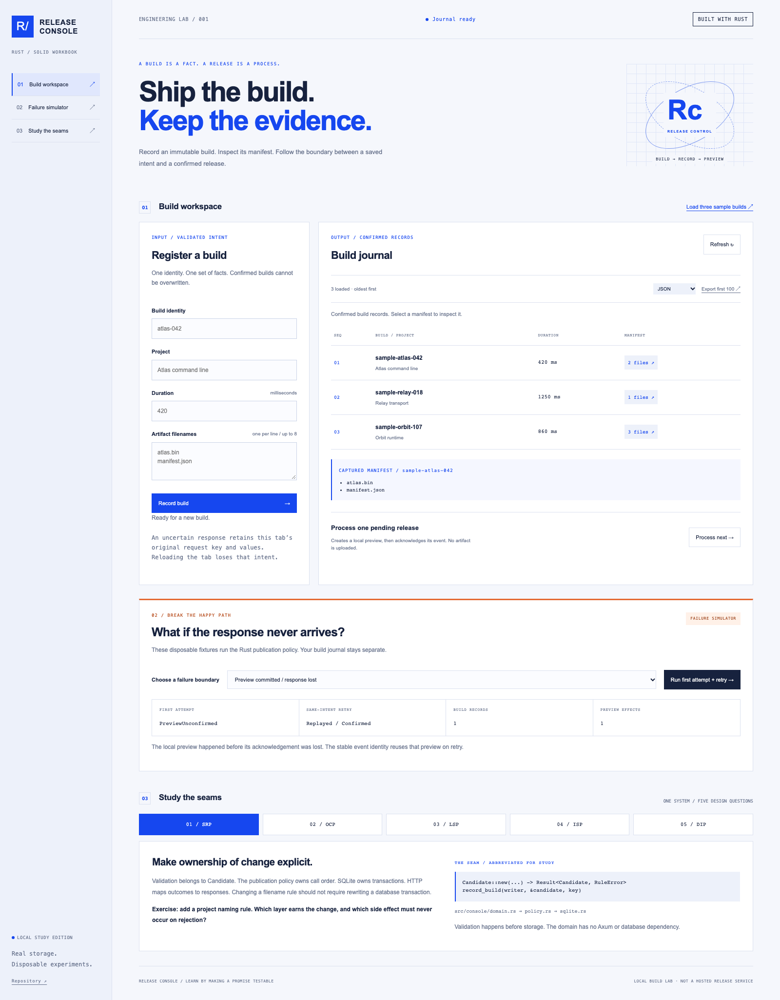

# Release Console · SOLID in Rust

**A build is a fact. A release is a process.**

A working Rust build journal with a browser console, durable request identities, extensible reports and a disposable failure simulator. Study each SOLID principle independently, then trace all five through one system.



## Run the console

Install stable Rust with Cargo, rustfmt and Clippy. Building bundled SQLite needs a C compiler (Xcode command-line tools on macOS; a normal C build toolchain on Linux). No Node or Python package install is needed to run the app.

```sh
cargo run --locked --bin release-console
```

Open **http://127.0.0.1:5190**. Choose **Load three sample builds** explicitly, or register your own. Records persist in ignored `data/releases.sqlite3`. Nothing uploads, publishes externally or sends email.

```sh
# Disposable storage; intentionally loses data on restart:
cargo run --locked --bin release-console -- --memory
# OCP: compose one more renderer without changing intake/publication:
cargo run --locked --bin release-console -- --markdown
# Alternate local port or database:
cargo run --locked --bin release-console -- --port 5192 --database data/alternate.sqlite3
```

Stop the previous server before starting a replacement on the same port. The server binds loopback only. This is a local study tool, not a public deployment.

## Choose your learning depth

| Principle | Foundation | In the running system |
| --- | --- | --- |
| SRP | [Build journal](lessons/1-srp/README.md) | [Validation, storage and publication boundaries](lessons/1-srp/system/README.md) |
| OCP | [Report bench](lessons/2-ocp/README.md) | [Composed report renderers](lessons/2-ocp/system/README.md) |
| LSP | [Fixed artifact manifest](lessons/3-lsp/README.md) | [Memory/SQLite behavioural contracts](lessons/3-lsp/system/README.md) |
| ISP | [Borrowed build board](lessons/4-isp/README.md) | [Reader, writer, queue and preview capabilities](lessons/4-isp/system/README.md) |
| DIP | [Release desk](lessons/5-dip/README.md) | [Policy-owned ports and failure recovery](lessons/5-dip/system/README.md) |

The original five CLI lessons remain available with `cargo run --locked -- all`, or replace `all` with `srp`, `ocp`, `lsp`, `isp`, `dip`.

[Rust orientation](docs/RUST_START.md) · [Study path](docs/LEARNING_PATH.md) · [Guided tour](docs/WALKTHROUGH.md) · [Architecture](docs/ARCHITECTURE.md) · [API](docs/API.md) · [Interview practice](docs/INTERVIEW_PREP.md)

## Verify

```sh
cargo fmt --check
cargo clippy --all-targets --locked -- -D warnings
cargo test --all-targets --locked
cargo build --bins --locked
python3 scripts/check_docs.py
python3 scripts/smoke_console.py
```

Python 3.9+ is sufficient for the standard-library tooling. The smoke check uses its own database and port, restarts real processes, and verifies that SQLite history/request bindings/acknowledgements persist while memory storage does not.

Optional browser checks require Node 22+:

```sh
cd tooling/browser
npm ci
npx playwright install chromium
npm test
```

The current suite has **63 Rust tests and eight browser tests**.

CI runs Rust checks, the foundation demonstrations, local documentation links, real HTTP restarts and Playwright flows. The [verification notes](docs/VERIFICATION.md) distinguish tested behaviour from limitations.

## Why Rust?

Private validated values, owned projections, `Result` variants, borrowed capability traits, `Arc` and `Mutex` make several boundaries explicit. Rust still cannot prove that an implementation honours domain promises such as idempotency or stable ordering; those have behavioural contracts.

The system uses real transactions and a stable local preview identity to study uncertain acknowledgements. It does not claim exactly-once delivery to external systems. There is no artifact upload, authentication, background release worker, deployment pipeline or automatic schema migration.

## Related projects

[Swift](https://github.com/aguamonkey/SOLID-Principles-with-Swift) · [TypeScript](https://github.com/aguamonkey/solid-principles-typescript) · [Python](https://github.com/aguamonkey/solid-principles-python) · [Connected ecosystem](https://github.com/aguamonkey/solid-ecosystem)

This workbook remains independent. The later ecosystem Rust collector will reuse the reasoning about immutable intent and retries, rather than importing this release domain mechanically.

[Contributing](CONTRIBUTING.md) · [MIT licence](LICENSE)
