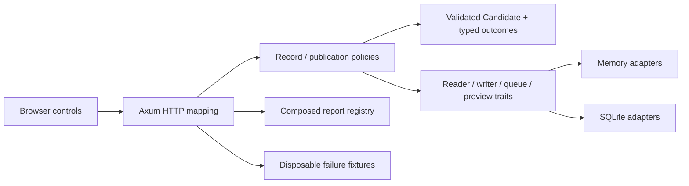

# Release Console architecture

[Repository](../README.md) · [Walkthrough](WALKTHROUGH.md) · [API](API.md)

## Ownership of change

`console/domain.rs` owns invariants and wire/domain conversion. `ports.rs` names behavioural capabilities. `policy.rs` owns supplier order and uncertainty. `exports.rs` owns rendering selection. Adapters own persistence or local effects. The executable chooses implementations; HTTP translates requests and statuses.
The browser owns form intent and presentation. It renders user values through DOM `textContent`; its input checks are convenience checks, while Rust remains authoritative.

The original foundation `Build` is a tiny example. The system's `Candidate` adds identity, artifact rules and bounded input. These are intentionally different learning scopes; the larger type does not retroactively burden the foundation exercise.

## Durable intent

SQLite inserts build, request-key binding and pending release event in one `BEGIN IMMEDIATE` transaction. Conflict exits without overwrite. A trigger-based test forces the final insert to fail and confirms rollback of the earlier inserts.
The request body is serialized from a validated value, with stable field and artifact order. Artifact order is part of exact intent; a reordered list conflicts under the same key.
Preview creation is a separate transaction. It binds stable event identity to content and receipt. Queue acknowledgement follows it. Lost responses can leave effects unconfirmed; replay does not imply that the original operation failed.

## Thread and async boundaries

The HTTP state shares an `Arc` containing a mutex-protected connection. Async handlers put synchronous work on `spawn_blocking`; no lock guard crosses an `.await`. The publication policy releases each adapter's lock before calling the next supplier.
This deliberately favours a small, understandable local service. The blocking pool is not an admission-control policy; high-load limits, pooling and bounded scheduling would need separate design.

## Two contracts, two scopes

The foundation manifest promises fixed successful snapshots. The running journal promises ordered, append-only records with owned projections and exact retry/conflict semantics. It may grow between reads. Do not pretend those contracts are interchangeable just because both return a list.
Memory and SQLite share the common storage contract, but only SQLite promises process-restart durability. A memory fixture is not evidence of disk recovery.

## Deliberate limits

- Local loopback service, 16 KiB HTTP body limit, 1–100 rows per page, bounded candidate fields.
- No auth, tenants, artifact bytes/uploads, external publishing, background worker, leases, backoff, dead-letter handling or backups.
- One process-local connection is serialized; independent SQLite connections are tested for same-key races. The design is not a high-throughput release service.
- A poison first event can block the queue. A worker tick processes the next event, so retrying that HTTP endpoint may process a different event.
- Schema version 1 is explicit; unknown versions fail instead of being silently downgraded. No migration framework is implemented.
- Browser intent survives only while the tab remains open; it is not a persistent client outbox.
- Preview idempotency concerns a local stored effect. It does not prove exactly-once remote delivery or successful artifact publication.

These choices are documented reasoning, not a claim that SOLID requires this number of modules.
